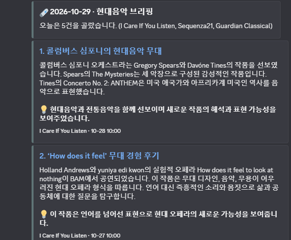

# 현대음악 뉴스레터 에이전트

영어 현대음악 매체의 RSS 피드를 모아서, 그 주에 읽을 만한 기사 5건을 고르고, 본문을 읽고 **한국어 요약과 인사이트**를 만든 뒤, 원문과 대조해 검수하고, 통과한 것만 Discord로 발행하는 [LangGraph](https://langchain-ai.github.io/langgraph/) 에이전트입니다.



> 설계 판단, 소스 채택표, 선별 로직, 구조도, 회고는 **[REPORT.md](REPORT.md)** 에 있습니다.

## 파이프라인

```
START → ① collect → ② select ─┬→ ③ report ×N (기사별 병렬) ─┐
                              └→ (선별 0건이면 바로) ───────┴→ ④ verify → ⑤ publish → END
```

| 단계 | 하는 일 | 핵심 장치 |
|---|---|---|
| ① collect | RSS 4곳에서 최근 2주 글을 모은다 | 같은 주소는 한 번만, 응답 없는 소스는 이름을 로그에 남김 |
| ② select | 중요도로 5건을 고른다 | 예선(묶음별) → 본선(한 화면 비교), 같은 사건 1건·매체당 2건, **정치성 기사 제외(프롬프트 + 코드)** |
| ③ report | 본문을 읽고 headline·summary·why 세 칸으로 요약 | 형식은 코드로 검사하고 어기면 사유를 알려 최대 3번 재생성 |
| ④ verify | 요약이 원문에 근거하는지 대조 | 연도 글자 대조 + 별도 LLM 대조, 통과 못 하면 버리고 사유 기록 |
| ⑤ publish | 검수를 통과한 것만 Discord embed로 발송 | 기본은 **보내지 않음**, 발송 실패를 dry-run으로 표시하지 않음 |

## 빠른 시작

개발·검증은 Python 3.14에서 했습니다(다른 버전은 확인하지 못했습니다).

```bash
git clone https://github.com/hojitea-ui/my-newsletter.git
cd my-newsletter
python -m venv .venv
source .venv/bin/activate          # Windows: .venv\Scripts\activate
pip install -r requirements.txt

cp .env.example .env               # 그리고 .env 에 OPENAI_API_KEY 를 채운다
python run.py                      # 수집→선별→취재→검수까지 돌리고 '보내지 않는다'(dry-run)
python run.py --send               # 검수를 통과한 결과를 실제로 발행 (DISCORD_WEBHOOK_URL 필요)
```

| 명령 | 설명 |
|---|---|
| `python run.py --hours 72` | 수집 time window를 바꿔서 실행(기본 336시간) |
| `python run.py --no-metrics` | `store/metrics.jsonl`에 기록하지 않고 실행 |
| `python audit_sources.py` | 소스 후보를 같은 기준으로 다시 측정해 `store/source_audit.json` 갱신 |

실행하면 단계별 로그가 출력되고 한 줄이 `store/metrics.jsonl`에 쌓입니다.

```
① 수집   336시간 time window · 25건
② 선별   22 → 예선 12 → 5건 · 발행 비율 0.42 · 정치성 3건 제외 · 정치성 본문 1건 제외
④ 검수   5 → 5건 · 불합격 0건
⑤ 발행   5건 · 보냄
```

## 설정

기준과 수치는 코드가 아니라 **[audience.yaml](audience.yaml)** 에서 바꿉니다.

| 항목 | 내용 |
|---|---|
| `audience` | 타깃 독자 페르소나 |
| `importance` | 중요도 판단 문장, 포함·제외 기준(프롬프트에 들어감) |
| `exclusion_rules.politics` | 정치 제외 낱말과 본문 임계값(`body_hits_threshold`) |
| `sources` | RSS 소스 목록(일반 뉴스 소스는 `topic_keywords`로 주제 필터를 붙일 수 있음) |
| `pipeline` | 수집 기간, 묶음 크기, 예선 통과 수, 최종 건수, 매체 상한, 모델 |

비밀 값은 `.env`에만 둡니다(`.gitignore`에 들어 있어 커밋되지 않음). 항목은 [.env.example](.env.example)을 보세요.

## 안전장치

- **`--send` 없이는 보내지 않습니다.** `.env`에 `DRY_RUN=0` 같은 값이 있어도 `run.py`는 `--send`가 있을 때만 발송합니다.
- **검수가 전부 API 오류로 끝나면 보내지 않고 실행을 실패로 끝냅니다.** 크레딧 소진 같은 오류를 "오늘은 조용합니다"로 보내면 소식이 없는 날과 구분이 안 되기 때문입니다. 보내지 못한 기사는 기록되지 않아 다음 실행에서 다시 고릅니다. 일부만 실패한 날은 통과한 기사만 보냅니다.
- **웹훅 주소와 API 키는 저장소에 없습니다.** 실행 기록(`metrics.jsonl`)에도 본문 전문, 주소, 키를 넣지 않습니다.
- **본문 전문을 재배포하지 않습니다.** 발행물에는 요약과 원문 링크만 들어갑니다.

## 매일 자동 실행 (GitHub Actions)

[.github/workflows/daily.yml](.github/workflows/daily.yml)이 **매일 아침 7:30(한국 시간)** 에 파이프라인을 돌립니다. 기본은 보내지 않는 dry-run이고, 아래를 설정해야 실제로 발송합니다.

1. 저장소 **Settings → Secrets and variables → Actions → Secrets** 에 `OPENAI_API_KEY`와 `DISCORD_WEBHOOK_URL`을 추가합니다.
2. 같은 화면의 **Variables** 에 `DAILY_SEND` = `true`를 추가하면 정해진 시각 실행이 발송까지 합니다. 변수가 없거나 `true`가 아니면 dry-run입니다.
3. 처음에는 **Actions 탭 → daily-briefing → Run workflow** 로 손으로 실행해 보세요. `send`를 끄면 dry-run, 켜면 실제 발송입니다.

- **중복 발행 방지:** 발송에 성공한 기사의 주소를 `store/sent.jsonl`에 기록하고 다음 실행의 수집에서 건너뜁니다. 발송한 날에는 이 파일과 `store/metrics.jsonl`이 저장소에 자동 커밋됩니다(dry-run은 기록하지 않습니다).
- **새 글이 없는 날:** "오늘은 조용합니다" 카드 한 장을 보냅니다(멈춘 건지 소식이 없는 건지 구분하려고).
- **주의:** 공개 저장소라서 Actions 실행 로그(기사 제목·요약·링크)도 누구나 볼 수 있습니다. 비밀 값은 GitHub이 로그에서 가립니다. 실행마다 OpenAI 호출 비용이 약간 듭니다.

## 폴더 구조

```
├── graph.py                # LangGraph 워크플로우(5노드, State, 검수·발행 로직)
├── run.py                  # 실행 스크립트(--send, --hours, 실행 기록 저장)
├── audience.yaml           # 독자, 중요도 기준, 제외 조건, 소스, 파이프라인 수치
├── audit_sources.py        # 소스 후보 측정 스크립트
├── requirements.txt        # 의존성
├── .github/workflows/daily.yml  # 매일 자동 실행(GitHub Actions)
├── store/
│   ├── metrics.jsonl       # 실행·검수 기록(실행 1회 = 1줄)
│   ├── sent.jsonl          # 이미 발송한 기사(중복 방지, 발송 후 생성)
│   └── source_audit.json   # 소스 채택표의 측정 원자료
├── docs/discord_result.png # 발행된 결과 화면
├── 실습파일.ipynb           # 강의 노트북을 따라 단계별로 만든 학습 원본
└── REPORT.md               # 프로젝트 보고서
```

## 한계

- 소스는 영어 해외 매체 4곳뿐입니다(국내 후보는 RSS·Atom을 찾지 못했습니다).
- 정치 필터는 영어 낱말 기준이고, 검수는 LLM 판정이 섞여 있어 확률적입니다.
- 자동 실행은 GitHub Actions의 cron에 맡기므로 정각에 도는 것이 보장되지 않고, 공개 저장소는 60일 동안 활동이 없으면 스케줄이 꺼질 수 있습니다.
- 중복 방지는 주소 기준이라, 같은 소식을 다른 매체가 쓴 경우는 선별 단계의 같은 사건 라벨이 막습니다.

자세한 내용은 [REPORT.md](REPORT.md)의 6절을 보세요.
