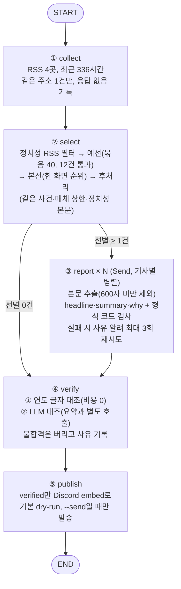

# 현대음악 뉴스레터 에이전트 — 프로젝트 보고서

영어 현대음악 매체의 RSS 피드를 모아서, 그 주에 읽을 만한 기사 5건을 고르고, 본문을 읽고 한국어로 요약·인사이트를 만든 뒤, 원문과 대조해 검수하고, 통과한 것만 Discord로 발행하는 LangGraph 에이전트입니다.

> **제출본은 태그 [`v1.0`](https://github.com/hojitea-ui/my-newsletter/tree/v1.0)입니다.** 이 저장소는 제출 뒤에 매일 자동 실행(GitHub Actions)이 `store/` 기록 파일을 갱신하므로 `main`은 계속 바뀝니다. 코드와 보고서는 태그와 같고, 달라지는 것은 `store/metrics.jsonl`과 `store/sent.jsonl`뿐입니다. 본문에서 "제출 시점"이라고 한 기록은 이 태그 기준입니다.

## 실행 방법과 제출 파일

```bash
pip install -r requirements.txt
# .env 에 OPENAI_API_KEY=... 를 넣는다 (발행하려면 DISCORD_WEBHOOK_URL=... 도)
python run.py           # 수집→선별→취재→검수까지 돌리고 '보내지 않는다'(dry-run, 기본값)
python run.py --send    # 검수를 통과한 결과를 실제로 발행
python audit_sources.py # 소스 후보를 다시 측정해 store/source_audit.json 갱신
```

| 파일 | 역할 |
|---|---|
| `graph.py` | LangGraph 워크플로우 메인 로직(5노드와 State) |
| `run.py` | 실행 스크립트. `--send`가 없으면 `.env`에 `DRY_RUN=0`이 있어도 보내지 않는다 |
| `audience.yaml` | 타깃 독자, 중요도 기준, 제외 조건(정치 낱말 포함), 소스, 파이프라인 수치 |
| `requirements.txt` | 의존성 |
| `store/metrics.jsonl` | 실행할 때마다 한 줄: 단계별 건수, 정치성 제외, 선별 라벨·이유, 검수 불합격, 발행 상태 |
| `store/source_audit.json` | 소스 후보 측정 원자료(채택표의 근거) |
| `.github/workflows/daily.yml` | 매일 자동 실행(제출 후 추가). 기본 dry-run, `DAILY_SEND=true`일 때만 발송 |
| `store/sent.jsonl` | 이미 발송한 기사 주소(중복 방지). 발송하면 생긴다 |
| `audit_sources.py` | 위 측정 스크립트 |
| `실습파일.ipynb` | 강의 노트북을 따라 단계별로 만든 학습 원본(코드는 `graph.py`로 옮겨 정리했다) |

---

## 1. 분야 및 독자 정의

**분야: Contemporary Classical Music(현대음악).** 선택 근거는 수집 가능성과 공백입니다.

- 해외에는 현대음악 전문 매체가 RSS를 공개하고 있다(I Care If You Listen, Sequenza21 등). 반면 국내 후보로 확인한 서울시립교향악단·예술의전당·통영국제음악재단은 홈페이지에서 RSS·Atom 링크를 하나도 찾지 못했다(아래 2절 측정). 한국어로 이 분야의 해외 소식을 모아 주는 곳이 마땅치 않다는 점이 한국어 브리핑의 필요를 만든다.
- 글이 주 단위로 나와서 매일이 아니라 **주간 흐름**을 보는 뉴스레터가 맞다. 그래서 수집 time window를 2주(336시간)로 잡았다.

**타깃 독자(페르소나)** — `audience.yaml`의 `audience.persona`

> 국내에서 현대음악을 챙겨 듣고 연주·작곡·기획하는 사람. 해외 매체의 새 작품·연주·논쟁을 따라가고 싶지만 영어 피드를 매일 훑을 시간은 없어서 '이번 주 무슨 일이 있었나'를 한국어로 짧게 받아 보기를 원한다.

이 독자에게 중요한 기사 / 버릴 기사 기준은 3절에 있다. 독자가 한국어 사용자이므로 모든 출력은 한국어(합니다체)로 쓰고, 작품명·인명은 원문 표기를 유지한다.

---

## 2. 소스 채택표

수집 가능한 후보 13곳과 국내 후보 3곳을 **같은 기준**으로 측정했다(`audit_sources.py`, 측정 시각 `store/source_audit.json`의 `measured_at`). 제외 목록(OpenAI, DeepMind, TechCrunch, The Verge, MIT TR, AI타임스)은 후보에도 코드에도 없다.

**판정 기준**

| 기준 | 내용 | 근거 |
|---|---|---|
| A 수집 가능 | HTTP 200이고 글이 1건 이상 파싱된다 | 열리지 않는 피드는 쓸 수 없다 |
| B 살아 있음 | 최근 2주(수집 window) 안에 새 글이 1건 이상 | 주소가 열려도 멈춘 피드가 있었다 |
| C 본문 추출 | 최신 글 3건 중 본문이 600자 이상인 것이 2건 이상 | RSS 요약만으로는 요약·검수를 못 한다. 600자는 취재 노드의 기준선과 같다 |
| D 주제 적합 | 현대음악 키워드가 제목·요약에 든 글의 비율. 30% 이상 채택, 10~30% 조건부 채택(선별 단계가 거름), 10% 이하 탈락 | 일반 뉴스는 선별 비용만 늘린다 |

**측정 결과**

| 소스 | HTTP | 글 수 | 최신 글 | 2주 내 | 본문(최신3, 자) | 현대음악 적합 | 판정 | 사용 | 근거 |
|---|---|---|---|---|---|---|---|---|---|
| I Care If You Listen | 200 | 24 | 23시간 전 | 8 | 5462/5286/6148 | 71% | **채택** | 사용 중 | A·B·C·D 모두 통과 |
| Sequenza21 | 200 | 10 | 12일 전 | 1 | 3485/3702/13519 | 50% | **채택** | 사용 중 | A·B·C·D 모두 통과 |
| VAN Magazine | 200 | 10 | 8일 전 | 2 | 725/2007/795 | 20% | **조건부 채택** | 사용 중 | A·B·C 통과, 현대음악 적합 20%(10~30%)라 선별 단계의 LLM 판단으로 거름 |
| Guardian Classical | 200 | 19 | 17시간 전 | 14 | 6985/3157/2290 | 47% | **채택** | 사용 중 | A·B·C·D 모두 통과 |
| Slipped Disc | 200 | 10 | 19시간 전 | 10 | 1782/507/343 | 10% | **탈락** | - | 본문 추출이 안 됨(C 미달) |
| NewMusicBox | 200 | 10 | 687일 전 | 0 | 4881/8174/5637 | 60% | **탈락** | - | 최근 2주 안에 새 글이 없음(B 미달) |
| theartsdesk | 200 | 10 | 321일 전 | 0 | 3387/7810/3691 | 10% | **탈락** | - | 최근 2주 안에 새 글이 없음(B 미달) |
| Gramophone | 403 | - | - | - | - | - | **탈락** | - | 피드가 열리지 않음(A 미달) |
| Bachtrack | 400 | - | - | - | - | - | **탈락** | - | 피드가 열리지 않음(A 미달) |
| The WholeNote | 500 | - | - | - | - | - | **탈락** | - | 피드가 열리지 않음(A 미달) |
| Classical Music Daily | 404 | - | - | - | - | - | **탈락** | - | 피드가 열리지 않음(A 미달) |
| NPR Music | 200 | 10 | 24시간 전 | 10 | 7755/5889/5063 | 0% | **탈락** | - | 현대음악 적합 0%(10% 이하)라 일반 뉴스로 봄 |
| NYT Arts·Music | 200 | 14 | 16시간 전 | 14 | 0/0/0 | 14% | **탈락** | - | 본문 추출이 안 됨(C 미달) |

| 국내 후보 | HTTP | 홈페이지에서 찾은 RSS·Atom 링크 |
|---|---|---|
| 서울시립교향악단 | 200 | 0개 |
| 예술의전당 | 200 | 0개 |
| 통영국제음악재단 | ConnectionError | 0개 |

**채택·탈락 설명**

- **채택 4곳:** I Care If You Listen(전문 매체, 최근 2주 8건), Sequenza21(전문 매체, 글이 드물어 2주 window에서 겨우 1건), Guardian Classical(일반 클래식 지면이지만 신작 리뷰가 많고 2주 14건), VAN Magazine(적합 20%라 조건부).
- **Slipped Disc는 처음엔 채택했다가 제외:** 처음에는 일반 클래식 뉴스라 주제 키워드 필터를 붙여 5번째 소스로 썼다. 필터를 통과한 글이 10건 중 1건뿐이었고, 이 보고서를 위해 같은 기준으로 재 보니 본문이 600자 이상인 글이 최신 3건 중 1건뿐(C 미달)이었다. **기준대로 제외**해서 시스템과 기준을 일치시켰다(`audience.yaml`에 사유 주석).
- **열린다고 쓸 수 있는 게 아니다:** NewMusicBox(최신 글 687일 전)와 theartsdesk(321일 전)는 HTTP 200으로 피드가 열리고 본문도 잘 뽑히지만 새 글이 없다. 처음엔 후보였지만 B 미달로 제외했다. Gramophone(403)·Bachtrack(400)·WholeNote(500)·Classical Music Daily(404)는 피드 자체가 열리지 않았다(A 미달).
- **NPR·NYT:** 음악 전체 섹션이라 현대음악 적합이 0%·14%. NYT는 본문도 추출되지 않았다(유료 지면).
- **국내 소스: 못 찾았다.** 세 곳 모두 홈페이지에서 RSS·Atom 링크가 0개(통영국제음악재단은 접속 자체가 실패). 국내 소스를 넣지 못한 것은 아래 회고의 개선점이다.

---

## 3. 선별 로직 설계

**중요도 판단 문장:** "이번 주 현대음악 흐름을 알려 줄 만한가"(`importance.question`). LLM에게 기준을 글로 주고(`audience.yaml`의 포함·제외 목록), 후보를 **서로 비교해** 순위를 매기게 한다.

- **고를 것:** 새 작품의 초연·위촉·신보 발매, 생존 작곡가·앙상블의 활동 / 현대음악 페스티벌·기획, 분야의 흐름이나 논쟁
- **버릴 것:** 바흐~말러 같은 정전 레퍼토리 중심 공연 리뷰, 현대음악과 무관한 부고·인사·스캔들, 시즌·티켓 홍보성 소식, 정치·선거·시위·사회운동이 중심인 기사

**2단계 구조(예선 → 본선)와 설정값**

| 단계 | 하는 일 | 설정 |
|---|---|---|
| 예선 | 후보를 묶음으로 나눠, 묶음마다 서로 모르는 채로 순위를 받고 상위를 통과시킨다 | `batch: 40`, `pass_per_batch: 12` |
| 본선 | 예선 통과분 12건을 **한 화면에** 놓고 전체 순위를 받는다 | 최종 `target: 5` |
| 후처리(코드) | 같은 사건 1건만(`event` 라벨), 매체당 `per_source: 2`건, 정치성 본문 건너뛰기, 부족하면 상한에 밀린 기사부터 채움 | 순위대로 한 건씩 검사 |

**왜 이렇게 설계했나(실측 근거)**

- **기사를 하나씩 따로 점수 매기지 않고 한 화면에서 비교한다.** 실습 노트북 7번 셀에서 15건에 1~10점을 따로 매겼더니 서로 다른 점수가 6개뿐이었고, 현대음악과 무관한 부고 기사가 8점으로 1위였다. 같은 15건을 한 화면에서 비교하게 하니 그 기사가 사라졌다.
- **묶음(`batch`)을 두는 이유와 40으로 정한 이유.** 목록이 길면 LLM이 중간 후보를 흘린다는 점(lost-in-the-middle)을 강의 자료에서 배워서 예선을 묶음으로 나눴다. 40은 강의 자료의 값을 따른 것이고, **현재 수집량(하루치가 아닌 2주치 약 25건)은 40보다 작아 사실상 묶음이 하나**다. 묶음을 나누는 효과는 소스를 늘렸을 때 의미가 생기며, 지금 데이터로는 검증하지 못했다.
- **예선 통과 12건은 실패에서 나온 값이다.** 처음 통과를 8건으로 뒀을 때, 매체 상한과 같은 사건 제외를 거치면 최종이 4건으로 모자란 적이 있었다. 본선 후보에 들어오는 매체가 3곳뿐이어서 `3곳 × 2건 = 6건`이 한계였고 사건 하나만 겹쳐도 미달이었다. 12건으로 늘리고 본선에서 전체 순위를 받아 두자 5건이 채워졌다(그래도 모자라면 상한에 밀린 기사부터 채우고 `relaxed`로 기록한다).
- **한 매체 쏠림 방지.** 한 화면 비교로 바꾸자 5건이 모두 I Care If You Listen에서 나왔다. 그래서 매체당 2건 상한을 두었다.

**기준이 의도대로 동작했다는 근거** — `store/metrics.jsonl`의 마지막 기록(`2026-10-29T17:50:30`)

| 항목 | 값 |
|---|---|
| 깔때기 | 수집 25 → 정치성 필터 후 22 → 예선 통과 12 → 선별 5 → 요약 5 → 검수 통과 5 → 발행 5 |
| 정치성 제외(RSS 제목·요약) | 3건: 파리 시위 오케스트라 기사, Joséphine 헌정 리뷰(activist), Igor Levit *Resistance* 음반 리뷰 |
| 정치성 제외(본문) | 1건: Shelley Washington 신작 리뷰(본문에 democracy·democratic·war 5회) |
| 예선 통과선 | 12등: LPO/Gardner·Mark Simpson 협주곡 리뷰 / 13등(첫 탈락): Bartók 음반 리뷰 |
| 본선 탈락 사유 | 매체 상한 3건, 순위 밖 3건, 정치성 본문 1건 — 사유를 건별로 남겼다 |

선별된 5건은 사건 라벨과 고른 이유를 함께 남겼다(예: `Steve Reich Music for 18 Musicians` — "스티브 라이히의 대표작 무대화 공연 리뷰로 현대음악 공연 기획과 해석에…"). 한계: 예선에서 떨어진 기사는 건별 사유를 남기지 않고 통과선만 기록한다.

**정치 제외 장치(강사님 요청: 정치 주제 금지)는 이중이다.** 프롬프트에 "정치·선거·시위·사회운동 중심 기사는 버린다"를 쓰는 것만으로는 부족해서(프롬프트는 부탁일 뿐이다), 코드로도 막는다. 처음에는 RSS 제목·요약에 정치 낱말이 있는 기사만 걸렀는데, 첫 실행(`store/metrics.jsonl` 첫 줄, 17:44)에서 이를 통과한 정치 주제 기사가 나왔다(요약에 "민주주의", "정치 권력에 맞서는" 등). 그래서 ① 낱말을 늘리고 ② 최종 후보의 **본문**을 직접 읽어 정치 낱말이 3회 이상이면 빼고 다음 순위로 채웠다. 임계값 3은 수집한 25건 본문을 직접 재서 정했다: 시위 기사 15회, 정치 주제 작품 4~5회, 나머지 0~2회.

---

## 4. 파이프라인 구조도



**State(`Brief`) 흐름**

| 칸 | 쓰는 노드 | 리듀서 | 설명 |
|---|---|---|---|
| `hours` | 입력 | - | 수집 time window |
| `collected` | collect | 덮어쓰기 | 수집한 기사(title, url, source, at, summary) |
| `picked` | select | 덮어쓰기 | 선별 5건(+ event, reason, body) |
| `drafted` | report 워커들 | `operator.add` | 기사마다 한 건씩 이어 붙임(fan-in) |
| `excluded` | report 워커들 | `operator.add` | 본문 부족·형식 위반으로 빠진 기사와 사유 |
| `verified` | verify | 덮어쓰기 | 검수를 통과한 것. **줄이는 칸**이라 리듀서가 없다 |
| `stats` | 모든 노드 | 딕셔너리 병합 | 단계별 통계 → `store/metrics.jsonl`로 |
| `log` | 모든 노드 | `operator.add` | 사람이 읽는 실행 로그 |

**검수 실패 시 대안(루브릭 4번):** 요약 형식이 틀리면 **재생성**(사유를 알려 최대 3회, 재시도는 온도를 올려 같은 답이 반복되지 않게 함, 헤드라인만 길면 그 칸만 따로 줄임). 검수에서 원문 근거가 없다고 판정되면 **스킵**(다시 쓰지 않고 버리고 사유를 로그와 `metrics.jsonl`에 남김). 그날 건수가 줄어도 통과한 만큼만 발행하고, 0건이면 "오늘은 조용합니다" 한 장을 보낸다.

---

## 5. 실행 기록

**① 검수를 통과해 정상 발행된 결과 화면.** 최종 코드로 `python run.py --send`를 실행해 개인 Discord 채널에 발행한 실제 화면이다(2026-10-29 오후 6:02, 머리말 카드와 기사 5건 전체).


**② 이 발행의 실행 기록** — `store/metrics.jsonl` 마지막 줄(`run_id` 2026-10-29T18:02:06, `dry_run: false`, 발행 상태 `sent`, 약 31초)

```
① 수집   336시간 time window · 25건
② 선별   22 → 예선 12 → 5건 · 발행 비율 0.42 · 정치성 3건 제외 · 정치성 본문 1건 제외
④ 검수   5 → 5건 · 불합격 0건
⑤ 발행   5건 · 보냄
```

위 캡처의 헤드라인 5개는 이 기록의 `result`와 일치한다. 발행은 Discord가 요청을 받아들일 때 돌려주는 HTTP 200/204를 받았을 때만 "보냄"으로 기록한다(실패하면 `발송 실패 — 위 출력의 상태 코드 확인`).

**③ 과제 제출 채널.** 실습 노트북에서 검수를 통과한 5건을 제출용 웹훅으로 발송했을 때도 `발행: 성공`, `⑤ 발행 5건 · 보냄`이 출력됐다. 제출 채널은 웹훅이라 직접 열람할 수 없어, 이 응답 코드로 전달 여부를 확인했다.

`store/metrics.jsonl`에는 **제출 시점에 실행 기록이 4줄** 있었다(이후 자동 실행이 발송한 날마다 한 줄씩 추가한다). 첫 줄은 3절에서 설명한 **정치 필터의 결함이 있던 실행**(dry-run), 둘째 줄은 낱말·본문 확인을 넣은 뒤(Slipped Disc 포함 5곳), 셋째 줄은 Slipped Disc를 제외한 최종 구성(dry-run), 넷째 줄은 최종 구성으로 **실제 발행**한 기록이다. 첫 줄은 증거로 일부러 지우지 않았다.

---

## 6. 프로젝트 회고

**가장 공들인 부분 — "틀리는 곳을 코드로 잡고, 그 장치도 시험한다"**

1. **검수(④).** 처음에는 LLM 대조 하나로 충분하다고 봤다. 일부러 틀린 요약을 넣어 시험해 보니 숫자를 바꾼 가짜와 근거 없는 문장은 잡았지만, 원문에 없는 연도("2023년")를 지어 넣은 요약을 한 번 통과시켰다. 그래서 비용이 없는 연도 글자 대조를 LLM 앞에 붙였다. 그러자 반대 방향의 오류가 났다: "1960~70년대"(원문은 1969·1970년)를 불합격 처리한 **오탐**이었다. 연대 표현은 그 연대 안의 연도가 원문에 있으면 통과시키도록 고쳤다. 검수가 놓치는 것과 과하게 잡는 것을 둘 다 측정해서 고친 과정이 가장 배운 것이 많았다.
2. **요약 형식.** 헤드라인 길이·세 문장·합니다체·한 문장 why를 프롬프트와 스키마 설명으로 요청했는데 5건 중 5건이 규칙을 어겼다(헤드라인이 22~71자, why가 2문장). 출력만 보고 확인할 수 있는 규칙은 코드로 검사하고, 어기면 사유를 알려 다시 쓰게 하니 위반이 5건에서 0건이 됐다.
3. **정치 주제 제외.** 위 3절. 첫 실행에서 필터를 통과한 정치 주제 기사를 직접 발견했고, 임계값을 감이 아니라 본문 측정으로 정했다.
4. **로그를 믿지 않기.** 발행 단계에서 전송이 실패했는데 로그에는 `dry-run`이라고 찍혔다(삭제된 웹훅 주소를 썼는데, 코드가 '전송 실패'와 '보내지 않음'을 구분하지 않았다). 지금은 `dry-run / 보냄 / 발송 실패`가 서로 다르게 표시된다. 발행은 되돌릴 수 없어서 기본값을 '보내지 않음'으로 두고, `run.py`는 `--send` 없이는 어떤 설정으로도 보내지 않게 했다.

**아쉬운 점과 앞으로 보완하고 싶은 것**

- **국내 소스가 없다.** 확인한 국내 후보 3곳에는 RSS·Atom이 없었다. 네이버 블로그 RSS, 매체의 비공식 피드 등을 더 찾아야 한다.
- **자동 실행과 중복 방지는 제출 뒤에 추가했다.** 매일 아침 실행하는 GitHub Actions 워크플로(`.github/workflows/daily.yml`)와, 발송한 기사 주소를 `store/sent.jsonl`에 기록해 다음 실행에서 건너뛰는 장치를 넣었다. 기본은 보내지 않는 dry-run이고 저장소 변수 `DAILY_SEND=true`일 때만 발송한다. 추가한 뒤 Actions에서 직접 확인했다: `send`를 끄고 실행하면 보내지 않고(dry-run), 켜고 실행하면 5건이 발송되고 봇이 `sent.jsonl`과 `metrics.jsonl`을 저장소에 커밋한다. 이어서 dry-run으로 다시 돌렸을 때 로그에 `이미 발행 5건 제외`가 찍혀 서버에서도 중복 방지가 동작함을 확인했다. 아직 확인하지 못한 것은 **정해진 시각(cron)에 저절로 도는 실행**이다. cron은 정각 실행이 보장되지 않고, 공개 저장소는 60일 동안 활동이 없으면 스케줄이 꺼질 수 있다.
- **중복 방지는 주소 기준이다.** 같은 소식을 다른 매체가 쓴 경우는 선별 단계의 `event` 라벨이 막지만, 라벨이 다르게 붙으면 둘 다 나갈 수 있다.
- **정치 필터는 영어 낱말 기준이다.** 영어 피드만 쓰는 지금은 맞지만, 한국어 소스를 넣으면 한국어 낱말과 임계값을 다시 재야 한다. 낱말 기반이라 정치 이야기가 아닌 글을 과하게 거를 수도 있다(Joséphine Baker 헌정 리뷰가 'activist' 한 낱말로 빠졌다).
- **헤드라인이 문장 중간에서 끊긴 사례가 있었다(제출 뒤 보완).** 최종 발행의 4번 기사 헤드라인이 "Walshe·Venables 협업 작품 무대에"처럼 조사로 끝났다. 형식 검사가 글자 수와 '요약·후기'만 봤기 때문이라, 조사(에·와·을·를·은·는·에서·에게·으로)로 끝나는 헤드라인을 형식 위반으로 보고 다시 쓰게 하는 검사를 더했다. 5절의 캡처는 이 보완 이전 화면이다. 한계: '결과·성과·회의'처럼 조사로 보일 수 있는 명사는 걸리지 않게 목록을 좁게 잡았고, 그 밖의 어색한 끝맺음은 못 잡는다.
- **검수는 확률적이다.** LLM 판정이 같은 오류를 한 번 놓친 것처럼, 지금 장치는 "더 많이 잡는" 것이지 "전부 잡는" 것이 아니다. 숫자·고유명사 대조를 더 붙이거나 근거 문장을 함께 받는 방식을 검토할 수 있다.
- **묶음 크기를 검증하지 못했다.** 수집량이 적어 예선이 한 묶음뿐이다. 소스를 늘린 뒤에 묶음 크기별로 통과 기사가 달라지는지(묶음 운) 측정해야 한다.
- **저작권.** 기사 본문은 요약·검수를 위해서만 읽고, 발행물에는 요약과 원문 링크만 넣는다. 본문 전문은 저장소에도 기록에도 남기지 않았다(`body`는 State에만 있고 `metrics.jsonl`에서 뺀다).
